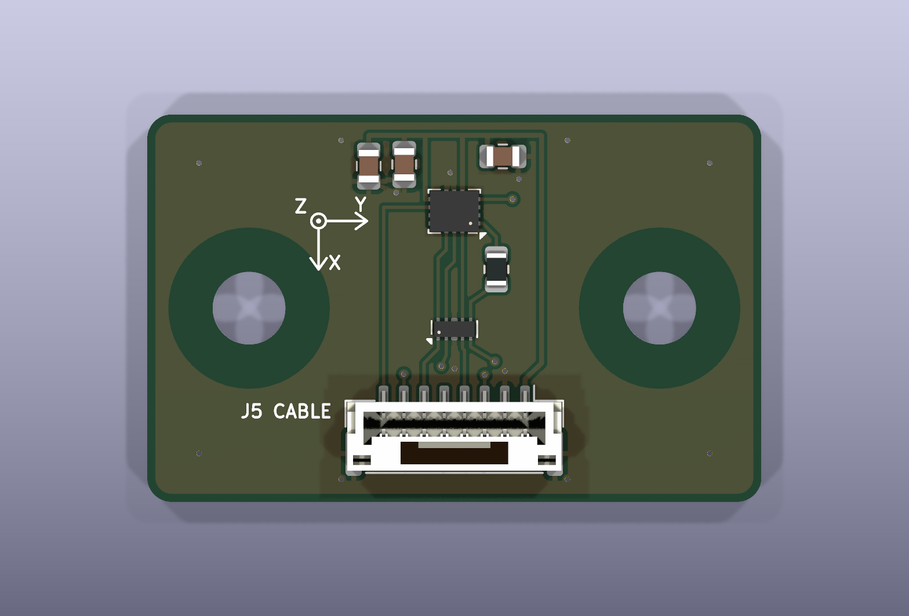
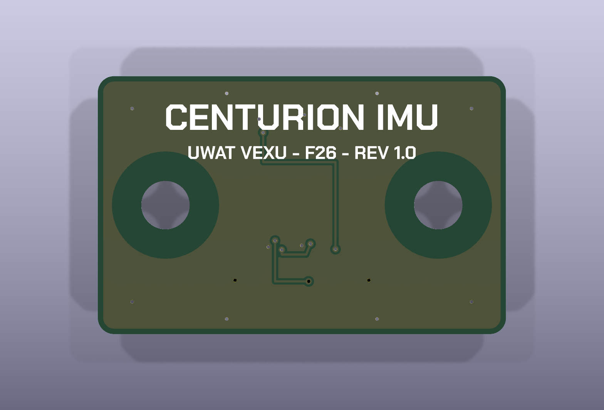

# centurion IMU board (imuBoard)

A small board that carries a Bosch BMI270 IMU. It plugs into centurion's J5 with a straight JST GH 8-pin cable. Designed 2026-11-04, rev 1.0.

| | |
|---|---|
| Size | 38 x 24 mm, 2 layers, 1.6 mm, GND pour on both sides |
| Mounting | Two #8-32 holes (4.5 mm), 25.4 mm (1 in) apart, so they land on VEX's 0.5 in hole grid. Not tied to GND, with a 5 mm copper keepout for the screw heads |
| IMU | U1 Bosch BMI270, 4-wire SPI, 10 MHz max |
| Connector | J1 JST GH 8-pin, vertical (BM08B-GHS-TBT, the same jack as centurion J5) |
| Parts cost | $9.39 per board; $47.69 for 4 boards plus spares ([bom/](bom/)) |
| Checks | ERC 0, DRC 0, schematic parity 0, 0 unconnected (KiCad 10.0.8, 2026-11-04) |

## Connector J1

The pinout matches centurion J5 pin for pin, so the cable is straight through (pin n to pin n). Keep it 30 cm or less: see [centurion/sim/README.md](../centurion/sim/README.md#connector-simulations). JST's pre-crimped 305 mm leads (AGHGH28K305) are exactly that long, and need no crimping. The cable parts are on centurion's BOM, Cables and tools tab.

| Pin | Signal | On the board |
|---|---|---|
| 1 | 3V3 | From centurion's SENS_3V3 (fused by F2). C3 1 uF bulk, C1 and C2 100 nF at the IMU |
| 2 | GND | |
| 3 | SCK | U2 ESD, then U1 SCx |
| 4 | MOSI | U2 ESD, then U1 SDx |
| 5 | MISO | U2 ESD, then R1 100 Ω, then U1 SDO |
| 6 | CS | U2 ESD, then U1 CSB. Centurion's R58 holds it high |
| 7 | INT1 | U1 INT1 (pin 4) |
| 8 | INT2 | U1 INT2 (pin 9) |

## Parts

| Ref | Part | Why |
|---|---|---|
| U1 | BMI270 (Bosch), LGA-14 2.5 x 3 mm | Chosen 2026-11-04. The ICM-42688-P, IIM-42652, ICM-45686 and ISM330DHCX were all out of stock at DigiKey Canada. The LSM6DSV16X was the other in-stock option (lower gyro noise, but $2.40 more). ASDx, ASCx, OCSB and OSDO are unconnected, as the datasheet allows |
| U2 | TPD4E05U06QDQARQ1 (TI) | ESD clamp on SCK, MOSI, MISO and CS, right at the jack. The same part as centurion U5. Flow-through: the traces run over pins 6, 7, 9 and 10, which are not connected inside |
| R1 | 100 Ω, 0805 | MISO series resistor at the IMU, matching centurion's R8, R9 and R41 on the other three lines |
| C1, C2 | 100 nF, 0805 | VDD (pin 8) and VDDIO (pin 5), each at its pin |
| C3 | 1 uF, 0805 | Bulk at the board input |
| H1, H2 | #8-32 holes | Not parts |

Every part except the BMI270 is already on centurion's BOM.

## Axes

The top silkscreen shows them next to H1: **+X toward J1, +Y toward H2, +Z up out of the board.** U1 is turned 180 degrees on the board, so this is the datasheet's frame (section 8.2) rotated. Firmware should use these printed directions, and remap to the robot's frame from how the board is mounted.

## Why R1 is there

R1 was sized with centurion's SPI simulation (`centurion/sim/spi_imu.cir`, J5 with 100 Ω R8/R9/R41, 10 MHz, BMI270 data 30 ns after SCK). In the deck, R1 adds to the IMU's output resistance (`ROIMU = 40 + R1`).

| R1 | MISO peak at centurion | Worst MISO crosstalk | 0.5 m at the fastest GPIO speed | MISO setup margin |
|---|---|---|---|---|
| none | 4.6 to 5.0 V | 0.92 V | fails (extra SCK edges) | 8.8 to 10.9 ns |
| 33 Ω | 4.0 to 4.1 V | 0.67 V | passes | 8.6 to 10.5 ns |
| **100 Ω (fitted)** | 3.3 to 3.6 V | 0.50 V | passes | 7.5 to 9.9 ns |

So with R1 fitted, every case up to 0.5 m passes. Keep the cable 30 cm or less anyway, and SPI1's GPIO speed low, as centurion's README says.

## Firmware notes

- **SPI:** mode 0 or 3, 10 MHz or less. Set SPI1's pins to GPIO speed low (OSPEEDR 00).
- **Start-up:** the BMI270 powers up in I2C mode. One dummy SPI read switches it to SPI. Then upload Bosch's 8 kB configuration file (`INIT_CTRL = 0`, burst-write `INIT_DATA`, `INIT_CTRL = 1`, wait for `INTERNAL_STATUS`) after every power-up. Bosch's BMI270 Sensor API (boschsensortec on GitHub) includes the config file and this sequence.
- **Interrupts:** INT1 and INT2 are push-pull outputs once configured. Map data-ready to INT1 (J5 pin 7).
- **Hot-plug:** plug the cable in with centurion off. A breakout plugged into a live jack dips SENS_3V3 (centurion/sim/README.md).

## Assembly

- **U1:** a land grid array with no leads, so solder it with paste and reflow or hot air, not an iron. The footprint is KiCad's Bosch LGA-14. Its pads are a little longer than Bosch's recommended 0.475 mm, which makes paste and rework easier.
- **U2:** the same 0.5 mm-pitch USON as on centurion.
- **The rest:** 0805 parts and the GH jack can be hand soldered.

## Files

| File | What it is |
|---|---|
| `imuBoard.kicad_pro`, `.kicad_sch`, `.kicad_pcb` | The KiCad 10 project. Design rules copied from centurion |
| `lib/imuBoard.kicad_sym` | BMI270 symbol, which uses the BMI160's pinout and package |
| `lib/imuBoard.pretty/` | The TPD4E05U06 DQA footprint (from centurion) and the axis graphic |
| `bom/imuBoard_revA_BOM.xlsx`, `bom/imuBoard_revA_DigiKey_upload.csv` | BOM in the centurion / powerJackal / stellaNova format, DigiKey Canada prices and stock from 2026-11-04 |
| `docs/` | 3D renders and the schematic as PDF and SVG |
| `tools/gen_imu.py` | Generated the library, schematic and board. **Rerunning it overwrites them**, so once the board is edited by hand in KiCad, stop using it |
| `tools/build_bom.py` | Builds the BOM files (needs `openpyxl`) |

## Before ordering

- **Footprint check:** run `pcb-footprint-checker` on this folder. Pay most attention to U1's pin 1 and orientation and U2's pin order.
- **Mounting position:** decide where it bolts on. Close to the robot's turning centre and on a stiff plate is best; foam tape under it helps with vibration.
- **Board name:** "CENTURION IMU" on the back is a working name. Rename it before ordering if the team wants one in the ramBar / stellaNova style.

