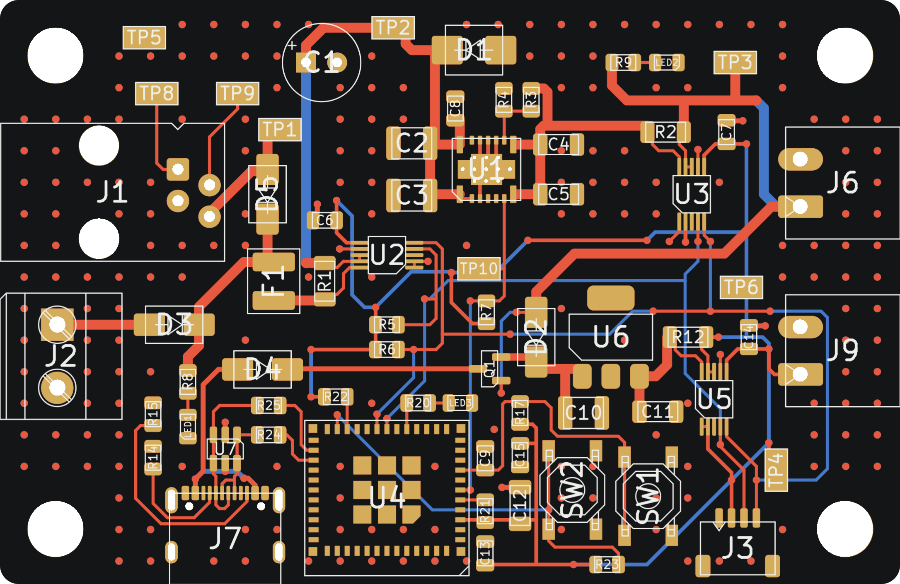

# powerJackal: smart port power test board, rev A

A small test board for the UWAT VEXU Centurion boards. It plugs into a VEX V5 smart port (or a bench supply), makes 5 V and 3.3 V, and measures the port input, the 5 V rail and the 3.3 V rail with three INA226 monitors. An ESP32-C3 module reads the monitors over I2C and reports over the USB-C port. An OLED can plug into the STEMMA QT connector.



## Status

Rev A design files. The KiCad design rule check shows 0 errors and 0 unconnected items, and the schematic netlist matches the board. Not built or tested yet. See [Before ordering](#before-ordering) for the checks still open.

## Board at a glance

| | |
|---|---|
| Size | 72.4 x 47.0 mm, 1.5 mm corner radius |
| Stackup | 2 layers, 1.6 mm FR-4, 1 oz copper |
| Mounting | 4 x 4.5 mm holes for #8-32 screws, 63.5 x 38.1 mm apart on the VEX 0.5 in grid, 4.45 mm from the edges |
| Parts | 59 placed parts, all on the top side, plus 9 bare copper test pads |
| Cost | About $63.53 CAD in parts per board at DigiKey Canada qty-1 prices, plus $6.26 for the J6 and J9 plugs. A parts order for 2 boards with spares is about $153.35 CAD at DigiKey's price breaks (checked October 29, 2026). Bare PCB not included |
| Inputs | J1 smart port (11 to 14.4 V battery), J2 bench supply 10 to 15 V |
| Outputs | J6 5 V up to 2 A, J9 3.3 V, J3 STEMMA QT (I2C + 3.3 V) |
| MCU | ESP32-C3-MINI-1U-N4X, USB serial and JTAG on USB-C |

## Folder map

| Path | What it is |
|---|---|
| `powerJackal.kicad_pro`, `.kicad_sch`, `.kicad_pcb`, `.kicad_dru` | The KiCad project. Open the `.kicad_pro` file |
| `fp-lib-table`, `sym-lib-table` | Point KiCad at the project library in `lib/` |
| `lib/` | Project library: UWAT symbols, footprints and the ESP32 3D model |
| `fab/revA/` | Gerbers and drill files (zip) plus the pick-and-place file |
| `bom/` | BOM spreadsheet with formulas, and a CSV for DigiKey BOM Manager |
| `docs/powerJackal_revA_schematic.pdf` | Schematic as a PDF |
| `docs/design_notes.md` | How the board works, layout rules, test plan, revision history |
| `docs/board_viewer/` | Interactive board page (3D, assembly, copper, schematic, BOM). Open the `.html` file in a browser |
| `docs/powerJackal_wiring_map.html` | Pin-by-pin wiring map of every part |
| `docs/images/` | Pictures that explain design changes |
| `tools/` | The Python scripts that generated rev A, plus layout checkers. See `tools/README.md` |
| `CLAUDE.md` | Instructions for Claude Code when working in this folder |

## Opening the project

1. Open `powerJackal.kicad_pro` in KiCad.
2. The board file is KiCad 10.0 format. It was saved with KiCad 10 for the rev A fixes, so KiCad 9 and older cannot open it. The schematic is still KiCad 7.0 format, and KiCad 10 upgrades it when you save. Commit a format upgrade by itself so the diff stays readable.
3. The UWAT library loads from `lib/` through the project library tables, so nothing needs to be installed. Everything else uses KiCad's standard libraries.
4. Many tracks are locked to protect the hand routing. Unlock a track (select it, then press L) before moving it.

## How it works, in short

- **Power in:** the smart port (J1) and the bench input (J2) each pass through a Schottky diode (D5, D3), so either can be plugged in alone or both at once. Then a 1.5 A polyfuse (F1), the input shunt R1, a TVS clamp (D1) and bulk capacitors.
- **5 V:** TI TPSM53602 step-down module (U1), up to 2 A. Shunt R2 measures the 5 V rail.
- **3.3 V:** MCP1826S LDO (U6), fed from the 5 V rail through D2. Shunt R12 measures the 3.3 V rail.
- **USB power switch:** Q1 (AO3401A) lets USB power the 3.3 V side only while the 5 V rail is off. On the desk, USB alone runs the ESP32 for flashing. With port or bench power on, USB only carries data, so the port readings never include USB current.
- **Measurement:** three INA226 monitors on one I2C bus.

| Monitor | Measures | I2C address | Shunt | Full scale |
|---|---|---|---|---|
| U2 | Port input, after F1 | 0x40 | R1, 20 mΩ | about 4 A |
| U3 | 5 V rail | 0x41 | R2, 20 mΩ | about 4 A |
| U5 | 3.3 V rail | 0x45 | R12, 50 mΩ | about 1.6 A |

## Quick reference

These notes used to be printed on the back of the board. They live here now.

- **Smart port pinout:** check the J1 pinout with a meter before the first plug-in.
- **USB-C:** flashes the ESP32-C3 and carries its serial output.
- **Stuck?** Hold BOOT, tap RESET, then let go of BOOT.
- **USB power:** USB powers the 3.3 V side only while port and bench power are off.
- **INA226 addresses:** 0x40 port input, 0x41 5 V rail, 0x45 3.3 V rail.

## Firmware quick start

- **Arduino IDE:** board "ESP32C3 Dev Module", set USB CDC On Boot to Enabled.
- **I2C:** `Wire.begin(4, 5)` (SDA GPIO4, SCL GPIO5). External 4.7 kΩ pull-ups are on the board.
- **Other pins:** status LED on GPIO10, PGOOD (5 V good) on GPIO3, active high.
- **INA226 calibration:** use a current LSB of 125 µA and CAL = 2048 for U2 and U3. Use 50 µA and CAL = 2048 for U5. The power LSB is 25 x the current LSB.
- **Recovery:** if a firmware bug breaks USB, hold BOOT (SW2), tap RESET (SW1), then let go of BOOT. The chip starts in its ROM download mode, which always works over USB.
- **Radio:** keep Wi-Fi and Bluetooth off. No antenna is fitted.

The full ESP32 pin map is in [docs/design_notes.md](docs/design_notes.md#esp32-c3-pins).

## Ordering boards

1. **Fab:** upload `fab/revA/powerJackal_revA_gerbers.zip` to the board house.
   - 2 layers, 1.6 mm, 1 oz copper, any solder mask color.
   - Tented vias. Ask them to tent or plug the vias in U1's exposed pad if they offer it.
2. **Parts:** upload `bom/powerJackal_revA_DigiKey_upload.csv` to BOM Manager on digikey.ca.
   - Set the number of boards in the yellow cell of the spreadsheet first. Quantities include spares.
   - To buy a different quantity of a part, type it in the yellow Your order qty column. The unit price follows DigiKey's price breaks, and the Tip column shows when buying up to the next break costs less.
   - After changing quantities, save the DigiKey upload tab as CSV and upload that instead.
3. **Assembly:** `fab/revA/powerJackal_revA_positions_top.csv` gives part centers in mm from the bottom-left board corner, top side only.

## Before ordering

- **J1 pinout:** check the smart port pinout with a meter on a powered brain. The board assumes yellow = power, green = GND, red = RS-485 B, black = RS-485 A.
- **J1 footprint:** this is a placeholder until it is checked against the Molex 0955012441 drawing. Test-fit a real VEX smart cable.
- **Port current:** VEX publishes no rating for the port power pin. Keep the added load at 20 W or less (about 1.6 A at 12.8 V). This board pulls about 12 W with 2 A on the 5 V rail.

## Regenerating outputs after a change

Run these from this folder. On Windows, use the KiCad Command Prompt, or call `kicad-cli.exe` from the KiCad `bin` folder.

```
kicad-cli pcb drc -o drc.rpt powerJackal.kicad_pcb
kicad-cli sch export pdf -o docs/powerJackal_revA_schematic.pdf powerJackal.kicad_sch
kicad-cli pcb export gerbers -l F.Cu,B.Cu,F.Paste,B.Paste,F.Silkscreen,B.Silkscreen,F.Mask,B.Mask,Edge.Cuts --subtract-soldermask --use-drill-file-origin -o fab/revA/gerbers/ powerJackal.kicad_pcb
kicad-cli pcb export drill --excellon-separate-th --drill-origin plot -o fab/revA/gerbers/ powerJackal.kicad_pcb
kicad-cli pcb export pos --format csv --units mm --side front --use-drill-file-origin -o fab/revA/powerJackal_revA_positions_top.csv powerJackal.kicad_pcb
```

Then zip the `fab/revA/gerbers/` folder into `powerJackal_revA_gerbers.zip`. If the board changes after rev A is ordered, put the new outputs in `fab/revB/` and keep `revA` as it was sent.

## Online copies

Private claude.ai pages with the same content as `docs/`. Share them from claude.ai before posting the links to the team.

- Board viewer: https://claude.ai/artifact/YNZmFietXBuHHMfKenqW3t
- Wiring map: https://claude.ai/artifact/1g2pL9suJduEafN7xD549V
